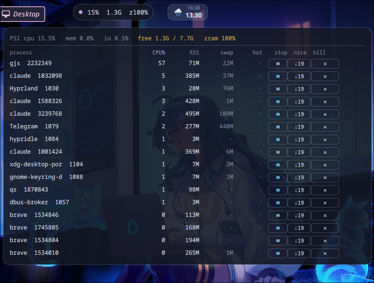

# zhor

**Who is eating this potato**

[](#model-credits)
[](https://github.com/Petyok/zhor/releases)
[](LICENSE)

> ⚠️ This project is 100% vibe-coded slop — see [Model credits](#model-credits)
> for who to blame; not a single line was written by a human. It has — and will
> keep having — stupid bugs LLMs can't see. It sends signals to your processes;
> the buttons do exactly what they say, which is the dangerous part. Use at your
> own risk.

A [quickshell](https://quickshell.outfoxxed.me/) + Hyprland widget: a pill in the
bar, a process list on click, and buttons to hold or kill — plus a CLI that tells
you what is stalling the machine.

Named after Russian *жор* — "the gorging".



## Why, when htop exists

Two things htop won't do while you are not staring at it:

* **CPU is a tick-to-tick delta.** `ps -o pcpu` reports the average over a
  process's whole lifetime, so a panel that has quietly eaten half a core for
  twelve hours shows up as 22% while it is actually at 57% right now.
* **PSI (`/proc/pressure`) is sampled, not just load.** On a weak laptop a freeze
  is almost never "something hit 100% CPU" — it is a memory stall: swap is full,
  the kernel is grinding through reclaim, everything waits. At that moment the
  CPU ranking names the wrong process, because a stalling machine makes every
  process look busy. When `memory full avg10` crosses the threshold, zhor looks
  for the culprit **by footprint and swap** instead.

Nothing is ever killed automatically. Deliberately: `rustc` at 250% CPU is a
correct `rustc`, and an autokiller would eat exactly that.

## Install

```bash
git clone https://github.com/Petyok/zhor ~/zhor && ~/zhor/install.sh
```

The installer is idempotent: it symlinks `~/.config/quickshell/zhor` and
`~/.local/bin/zhor`, appends two lines to `hyprland.conf` (with a backup), and
starts the widget immediately — no relogin.

```
exec-once = qs -n -p ~/.config/quickshell/zhor
bind = SUPER SHIFT, ESCAPE, exec, qs -p ~/.config/quickshell/zhor ipc call popup toggle
```

Removal: `~/zhor/uninstall.sh` drops the symlinks and cuts its own block back
out of the config, byte for byte.

Requires `quickshell` and `python3`. Nothing else — not a single pip dependency.

## The widget

**The pill** shows `PSI CPU% · free memory · swap used`. The dot on the left goes
green / amber / red with pressure and blinks on an alert. Click to open the list.
It hides itself over a fullscreen window.

**The list** (`SUPER+SHIFT+ESC`; Esc or a click outside closes it) is the top by
CPU and the top by RSS merged, plus swap and `hot` — how many seconds a process
has been over the line. Clicking the `CPU%` / `RSS` headers sorts.

| button | what it sends |
|---|---|
| `⏸` / `▶` | `SIGSTOP` / `SIGCONT` — freeze a process without losing its state |
| `↓19` | `renice -n 19` — let everything else have the CPU first |
| `✕` → `KILL` | first click `SIGTERM`, second one (within 5s) `SIGKILL` |

Buttons are greyed out for processes you don't own: without root `kill` returns
EPERM, and a button that silently does nothing is worse than a disabled one.

**Alerts** go to `notify-send`, once per process while the condition holds:

* `sustained` — a process over the line for a minute (≥90% of a core or ≥25% RAM);
* `stall` — the machine is genuinely blocked on memory (`memory full avg10` ≥ 10%).

## Embedding in your own bar

zhor is also a component. Quickshell only imports from inside the config
directory, so put the checkout there (symlink or git submodule):

```sh
ln -s ~/zhor ~/.config/quickshell/mybar/zhor      # or: git submodule add https://github.com/Petyok/zhor zhor
```
```qml
import "zhor" as Z
Z.Zhor { fsActive: myFullscreenFlag }   // an Item; place it like any other pill
```
The component owns its process list window and closes it on click-away.
`popupOpen` / `toggle()` are exposed for a keybind through your own IpcHandler.

## CLI — for humans and for agents

`install.sh` puts a symlink in `~/.local/bin/zhor`, so:

```console
$ zhor
VERDICT  MEMORY TIGHT: 1391M free, swap 100% full, biggest footprint Telegram(1079) — a stall is one heavy tab away
PSI      cpu 2.3%  mem 0.0%  io 0.0%   (avg10 = share of the last 10s spent stalled)
MEM      1.4G free of 7.7G   swap 100% used
TOP CPU  gjs(2232349) 59%  claude(1032098) 12%  claude(1588326) 5%
TOP MEM  Telegram(1079) 344M+439Msw  claude(3239768) 483M+107Msw
RECENT   3 alert(s) logged: 2x sustained gjs, 1x stall Telegram
$ echo $?
1
```

| command | what it does |
|---|---|
| `zhor` | one-shot snapshot and verdict, **exit 1 if the box is under pressure** |
| `zhor --json` | the same, machine-readable, with `verdict` and `recent` fields |
| `zhor recent --since 120` | alerts the daemon logged over the last two hours |
| `zhor watch` | the daemon itself, a JSON stream — this is what the widget runs |

Three decisions that matter more than the code:

* **A verdict on the first line.** The question is always "what is slow", never
  "give me numbers". The check order is not arbitrary: a memory stall outranks the
  CPU verdict, because during a stall everything looks busy and the CPU ranking
  points at the wrong process.
* **An exit code.** `zhor >/dev/null || collect-diagnostics` needs no parsing.
* **`recent`.** This is the part a snapshot cannot give you: a freeze gets asked
  about after it has ended, and by then the machine looks calm. The daemon is
  running anyway, so it writes alerts to `~/.local/state/zhor/events.jsonl`
  (last 2000, self-rotating, deduplicated per process).

There are deliberately **no `kill`/`renice` subcommands**: those already exist and
the report prints pids. Wrapping `kill` would be extra code and one more way to
hit the wrong thing.

## Configuration

Thresholds are flags; `zhor --help` lists them all.

```bash
zhor watch --interval 3 --cpu-hot 90 --rss-hot 25 --sustain 60 --stall-psi 10
```

Edit them in the `command:` line in `shell.qml`. The same file has the pill's
position (`pillRight`, `pillTop`), the palette and the colour thresholds at the top.

To catch a *permanent* hog rather than a build spike, lower the bar and raise the
window: `--cpu-hot 50 --sustain 300`.

Raw stream without the widget:

```bash
zhor watch | head -1 | python3 -m json.tool
```

## Tests

```bash
./test_zhor.py
```

Bare `assert`s, no framework: CPU delta arithmetic, the stuck-process counter,
alert triggering, shortlist selection, and verdict ordering.

## How it fits together

```
zhor.py     measures and decides: /proc + PSI, verdict, alert log, CLI
shell.qml   draws and forwards clicks; decides nothing on its own
```

The split is deliberate: everything that can be computed wrongly lives in the
Python, where it is covered by tests and runs without a compositor.

## Changelog

See [CHANGELOG.md](CHANGELOG.md).

## Model credits

Built end-to-end in a single session by **Opus 5 (1M context)** — recon, design,
the collector, the QML, the tests, the installer, this README, and the push.
Every number in here was measured on the machine it was written on, not guessed:
the CPU maths was cross-checked against `top` across 16 processes, and the
uninstall round-trip was diffed byte for byte.

The human contributed the idea, the name, the taste, the refusal to let it
autokill anything, one screenshot, and the swearing — including catching that
the repo description had gone out in the wrong language.

## License

MIT
